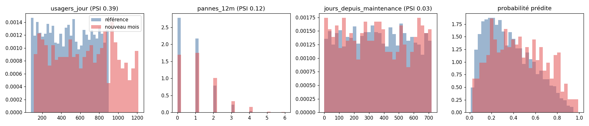

# J5 - Rapport de dérive

*Généré par `python -m forages.drift`. Ne pas modifier à la main.*

Modèle `20261025-00c9d345` ; référence : 2400 forages d'entraînement ; lot courant :
`forages_nouveau_mois.csv` (600 forages).

## Décision : **RE-ENTRAINER**

Raisons de ré-entraîner :
- dérive majeure de `usagers_jour` (PSI 0.39 ≥ 0.25)

Points de vigilance :
- 26% des valeurs de `usagers_jour` hors de la plage d'entraînement
- dérive modérée de `pannes_12m` (PSI 0.12)
- dérive modérée des prédictions (PSI 0.16)

## Dérive des variables

PSI : < 0.1 stable, 0.1 à 0.25 modérée, ≥ 0.25 majeure. Test KS (numériques) ou du chi²
(catégorielles) : une p-value < 0,05 signale une différence de distribution statistiquement significative. Pour les
catégorielles, les colonnes de moyenne donnent la part de la modalité la plus fréquente. `hors_plage` : part du lot
courant en dehors des valeurs vues à l'entraînement (min-max ou modalités) ; le modèle y extrapole.

| variable | réf. (moy. ou part) | courant | psi | p_value | test | hors_plage | niveau |
|---|---|---|---|---|---|---|---|
| usagers_jour | 483.959 | 642.553 | 0.392 | 0.000 | KS | 0.260 | majeure |
| pannes_12m | 0.767 | 1.135 | 0.116 | 0.000 | KS | 0.003 | modérée |
| jours_depuis_maintenance | 355.514 | 353.017 | 0.029 | 0.502 | KS | 0.000 | stable |
| profondeur_m | 88.206 | 90.995 | 0.022 | 0.261 | KS | 0.000 | stable |
| debit_m3h | 4.458 | 4.263 | 0.020 | 0.261 | KS | 0.000 | stable |
| age_ans | 15.234 | 14.813 | 0.008 | 0.638 | KS | 0.000 | stable |
| region | 0.262 | 0.232 | 0.008 | 0.271 | chi² | 0.000 | stable |
| type_pompe | 0.496 | 0.522 | 0.005 | 0.305 | chi² | 0.000 | stable |

## Dérive des prédictions

| | référence | nouveau mois |
|---|---|---|
| probabilité moyenne | 0.363 | 0.451 |
| part de forages à visiter | 0.587 | 0.715 |

PSI des probabilités prédites : **0.156** (modérée).

## Performance sur le lot courant

| métrique | test (référence) | nouveau mois |
|---|---|---|
| pr_auc | 0.606 | 0.740 |
| roc_auc | 0.751 | 0.781 |
| recall | 0.807 | 0.892 |
| precision | 0.506 | 0.557 |
| f2 | 0.721 | 0.796 |
| brier | 0.192 | 0.189 |
| taux_alerte | 0.580 | 0.715 |

Taux de panne observé : **0.447** ; probabilité moyenne prédite : **0.451** ; écart de calibration : **-0.005**.

La PR-AUC dépend du taux de panne (plus élevé ce mois-ci) : la comparaison se fait sur la ROC-AUC, le rappel et la calibration.

## Règle de ré-entraînement

- **RE-ENTRAINER** si une variable a un PSI ≥ 0.25, ou, une fois les étiquettes connues (90 jours plus tard),
  si le rappel au seuil passe sous 0.75, si la ROC-AUC perd plus de 0.05 par rapport au test, ou
  si l'écart entre taux de panne observé et probabilité moyenne prédite dépasse ±0.05.
- **SURVEILLER** si une variable ou les prédictions ont un PSI entre 0.1 et 0.25.
- **OK** sinon.

Le ré-entraînement se fait avec `python -m forages.retrain` (historique + données récentes étiquetées). Le modèle
challenger n'est promu champion que s'il fait mieux que le champion actuel sur des données récentes qu'il n'a pas vues.
