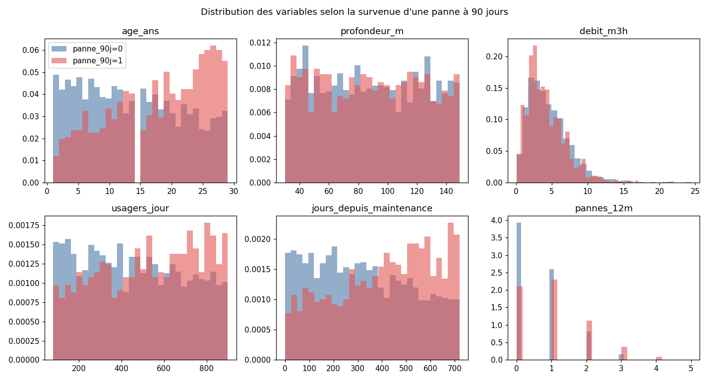
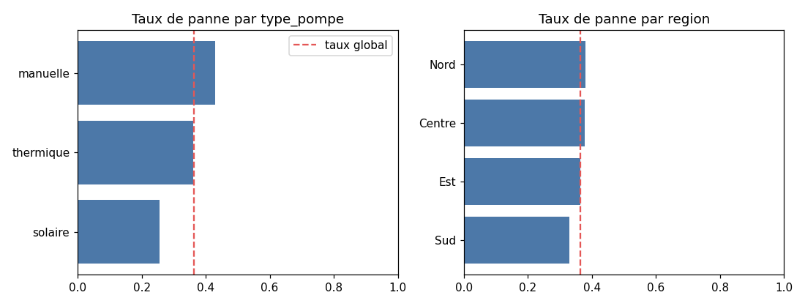

# J1 - Exploration des données

*Généré par `python -m forages.explore`. Ne pas modifier à la main.*

## Volumétrie et qualité

| Fichier | Lignes | Colonnes | Valeurs manquantes | Doublons | Taux de panne |
|---|---|---|---|---|---|
| forages_historique.csv | 3000 | 9 | 0 | 0 | 0.363 |
| forages_nouveau_mois.csv | 600 | 9 | 0 | 0 | 0.447 |

Les deux fichiers respectent le schéma attendu (types, modalités, bornes physiques : voir `forages/data.py`).
Lignes identiques entre l'historique et le nouveau mois : **0**.

Classe positive minoritaire (0.363) : un modèle qui ne prédit jamais de panne aurait
0.637 d'accuracy sans aucune utilité. L'accuracy est donc écartée.

## Variables numériques

| variable | mean | std | min | max |
|---|---|---|---|---|
| age_ans | 15.2 | 8.4 | 1.0 | 29.0 |
| profondeur_m | 88.7 | 35.0 | 30.0 | 149.0 |
| debit_m3h | 4.4 | 2.8 | 0.1 | 24.4 |
| usagers_jour | 486.5 | 237.5 | 80.0 | 899.0 |
| jours_depuis_maintenance | 354.2 | 207.2 | 0.0 | 719.0 |
| pannes_12m | 0.8 | 0.9 | 0.0 | 5.0 |

Taux de panne par type de pompe : {'manuelle': 0.43, 'solaire': 0.255, 'thermique': 0.361}
Taux de panne par région : {'Centre': 0.378, 'Est': 0.363, 'Nord': 0.379, 'Sud': 0.329}

## Contrôle des fuites de données

1. **Fuite par une variable** : AUC de chaque variable prise seule (une valeur proche de 1 serait suspecte).

| variable | AUC univariée |
|---|---|
| age_ans | 0.642 |
| jours_depuis_maintenance | 0.623 |
| pannes_12m | 0.611 |
| usagers_jour | 0.577 |
| debit_m3h | 0.542 |
| profondeur_m | 0.502 |

   Aucune variable ne sépare presque parfaitement les classes : pas de fuite évidente.
   Corrélations avec la cible : {'age_ans': 0.237, 'pannes_12m': 0.215, 'jours_depuis_maintenance': 0.205, 'usagers_jour': 0.128, 'debit_m3h': -0.069, 'profondeur_m': -0.003}.

2. **Fuite temporelle (à confirmer avec le métier)** : `pannes_12m` et `jours_depuis_maintenance` doivent être
   mesurés **à la date de prédiction**, sans inclure la fenêtre des 90 jours. Si une intervention consécutive à la
   panne remettait `jours_depuis_maintenance` à 0, la variable « verrait » la cible. Les forages à 0 jour ne
   présentent aucune panne et `jours_depuis_maintenance` augmente avec le risque : cohérent avec une mesure faite
   avant la panne. Hypothèse retenue et documentée.

3. **Fuite par le prétraitement** : encodage et normalisation sont dans un `Pipeline` scikit-learn, ré-appris
   dans chaque pli de validation croisée, jamais sur le test.

4. **Fuite par la sélection** : le jeu de test (20 %, stratifié, graine 42) n'est utilisé qu'une fois,
   pour le modèle final. Le choix du modèle et du seuil se fait en validation croisée sur le train.

5. **Pas d'identifiant** de forage : impossible qu'un même forage soit à la fois en train et en test sous deux lignes
   repérables ; aucune ligne dupliquée.

## Métrique retenue

- **Métrique de sélection : PR-AUC** (average precision). L'outil sert à **classer** les forages par risque pour
  répartir un nombre limité de visites ; la PR-AUC mesure la qualité de ce classement sur la classe minoritaire.
- **Seuil de décision** : le plus haut seuil qui garantit un **rappel ≥ 80%**. Rater une panne
  prive un village d'eau pendant des semaines ; une visite préventive inutile coûte une journée d'équipe.
  On rapporte aussi la précision au seuil (charge de visites inutiles) et le F2 (rappel pondéré ×2).
- ROC-AUC et score de Brier sont suivis en complément (discrimination et calibration).

## Modèles de référence (validation croisée 5 plis sur le train)

| Modèle | PR-AUC | ROC-AUC | Rappel | Précision | F2 |
|---|---|---|---|---|---|
| dummy_prior | 0.362 | 0.500 | 0.000 | 0.000 | 0.000 |
| regle_pannes_12m | 0.413 | 0.590 | 0.653 | 0.440 | 0.595 |
| logreg_reference | 0.651 | 0.754 | 0.800 | 0.496 | 0.713 |

Tout modèle candidat doit battre nettement la régression logistique de référence en PR-AUC.
