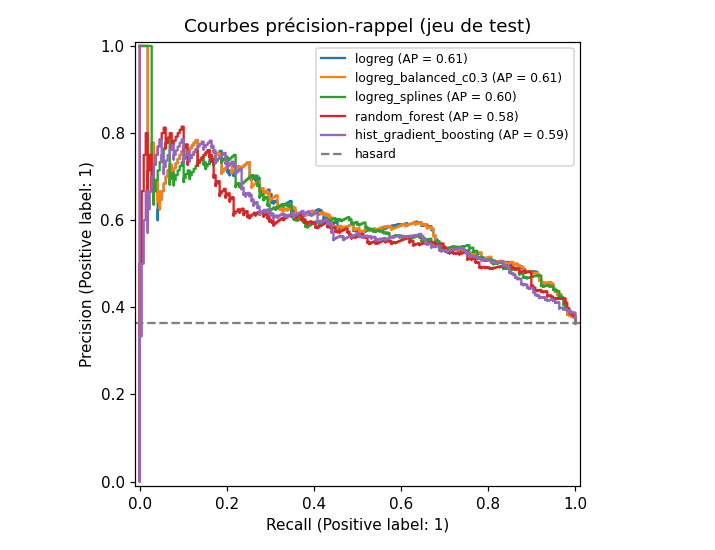
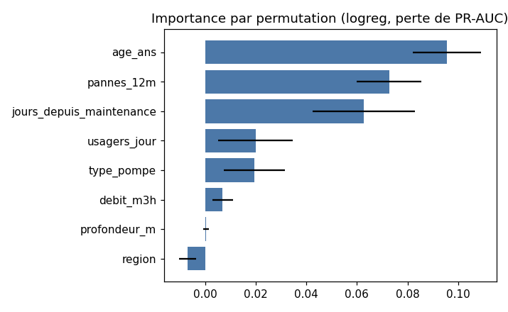

# J2 - Choix du modèle

*Généré par `python -m forages.train`. Chaque ligne est un run MLflow (expérience `forages-panne-90j`).*

## Comparaison des candidats

Sélection sur la **PR-AUC en validation croisée 5 plis** (train uniquement). Le seuil de chaque modèle est
choisi sur ses prédictions hors-pli pour garantir un rappel ≥ 80%, puis appliqué tel quel au test.

| modele | cv_pr_auc | cv_pr_auc_std | cv_roc_auc | seuil | test_pr_auc | test_roc_auc | test_rappel | test_precision | test_f2 | test_brier |
|---|---|---|---|---|---|---|---|---|---|---|
| logreg_balanced_c0.3 | 0.652 | 0.027 | 0.754 | 0.403 | 0.606 | 0.751 | 0.807 | 0.504 | 0.721 | 0.203 |
| logreg | 0.651 | 0.027 | 0.754 | 0.276 | 0.606 | 0.751 | 0.807 | 0.506 | 0.721 | 0.192 |
| logreg_splines | 0.645 | 0.026 | 0.745 | 0.276 | 0.602 | 0.746 | 0.812 | 0.500 | 0.722 | 0.194 |
| hist_gradient_boosting | 0.622 | 0.028 | 0.726 | 0.248 | 0.585 | 0.732 | 0.844 | 0.495 | 0.740 | 0.198 |
| random_forest | 0.615 | 0.031 | 0.724 | 0.373 | 0.582 | 0.732 | 0.835 | 0.492 | 0.733 | 0.203 |
| dummy_prior | 0.362 | 0.000 | 0.500 | 0.362 | 0.363 | 0.500 | 1.000 | 0.363 | 0.740 | 0.231 |

## Modèle retenu : `logreg`

- PR-AUC validation croisée : **0.651** (référence logistique : 0.651)
- Sur le test (jamais vu pendant la sélection) : PR-AUC 0.606, ROC-AUC 0.751,
  rappel 0.807, précision 0.506 au seuil 0.276
- Concrètement : sur 100 forages qui vont tomber en panne, environ 81 sont signalés ;
  sur 100 visites déclenchées, environ 51 concernent un forage qui allait réellement tomber en panne.
- Registre MLflow : `forages-panne-90j` version 1, alias `champion`.

**Argumentaire.**
- Le choix se fait uniquement sur la validation croisée pour ne pas sur-ajuster le jeu de test.
- Règle : meilleure PR-AUC de validation croisée ; si plusieurs modèles sont à moins de 0.005 les uns
  des autres (bien en dessous de l'écart-type entre plis, ≈ 0.027), le plus simple l'emporte.
- Les modèles à arbres (forêt aléatoire, gradient boosting) et la logistique à splines n'apportent aucun gain :
  le risque évolue de façon quasi linéaire avec l'âge, l'ancienneté de la maintenance, les pannes passées et la
  fréquentation. La logistique est en outre lisible (un coefficient par variable) et bien calibrée (Brier le plus bas),
  ce qui compte puisque l'API renvoie une probabilité.
- Rééquilibrer les classes (`class_weight="balanced"`) ne change pas le classement (même PR-AUC) mais dégrade la
  calibration : inutile, puisque le seuil est de toute façon ajusté pour le rappel cible.

